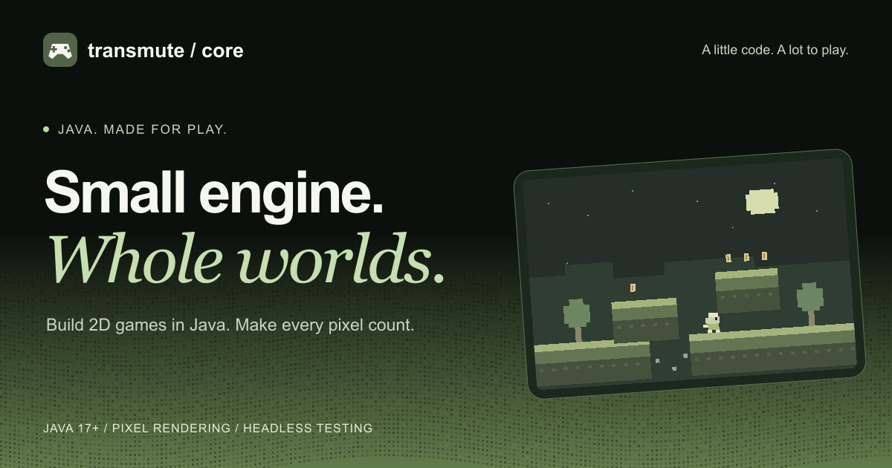

<p align="center"></p>

# Transmute Core



[](https://github.com/transmute-games/transmute-core/actions/workflows/ci.yml)
[](https://adoptium.net/)
[](build.gradle)
[](package.json)
[](.flox/env/manifest.toml)
[](https://github.com/transmute-games/transmute-core/releases)
[](LICENSE)

A focused Java engine for **2D pixel games**, with a fixed timestep loop,
pixel rendering, sprites, audio, tile worlds, and physics. The core has no
external runtime dependencies. The CLI scaffolds basic, platformer, and RPG games.

Build through `Manager`, declare resources with `GameSpec`, and verify behavior
with `GameHarness`, simulated input, pixel assertions, and audio probes—without a display.

## Start building

With [Flox](https://flox.dev/docs/install-flox/) installed:

```bash
flox activate
./gradlew :transmute-core:publishToMavenLocal
cd examples/hello
./gradlew test verifyHeadless
./gradlew run
```

Or install Java 17 and run the same Gradle commands without Flox.
The windowed `run` task requires a display; verification does not.

## Find your next step

- [Documentation](docs/README.md): setup, tutorials, and recipes.
- [API reference](docs/api/README.md): lifecycle, assets, worlds, and testing.
- [Examples](docs/EXAMPLES.md): verified starting points for your game.
- [Architecture](docs/ARCHITECTURE.md): how the engine fits together.
- [Contributing](docs/CONTRIBUTING.md): Flox, hooks, CI, releases, and LOC budgets.
- [Website development](docs/WEBSITE.md): Bun commands and content editing.

## License

[PolyForm Shield 1.0.0](LICENSE) · Copyright © 2026 transmute-games.
