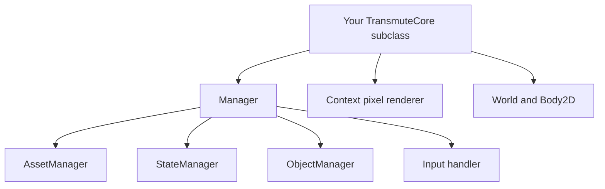
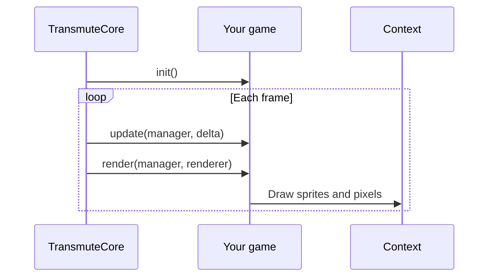

# Architecture

Transmute Core owns the loop and rendering surface. Your game supplies three callbacks and obtains services through `Manager`. The core has no external runtime dependencies.

## One authoring model

Call `manager.bootstrapDefaults()` in `init()` to install the standard managers. `GameContext` is the internal dependency container; game code should use `Manager`.

## Lifecycle

`init()` runs once. `update(Manager, double)` advances game logic using the engine's fixed timestep. `render(Manager, IRenderer)` draws the frame. Cast `IRenderer` to `Context` when you need pixel operations.

## Pick the built-in module

| Need | Use |
| --- | --- |
| Images, fonts, sound | `AssetPack` and `GameSpec` |
| Menus and gameplay screens | `StateManager`; leave a state with `pop()` |
| Tile worlds and triggers | `World` and `GameSpec.createWorld()` |
| Gravity and collision | `Body2D` and `Collision` |
| Repeatable tests | `GameHarness`, `SimulatedInput`, `FrameAssert`, `AudioProbe` |

Avoid building a parallel entity or map system. See the [API reference](api/README.md) and [authoring guide](AUTHORING.md) for concrete usage.
