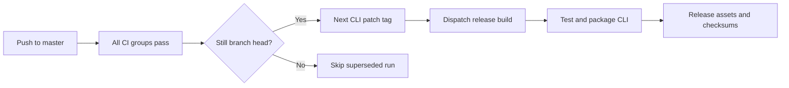

# Contributing

Use the same locked environment and commands locally and in GitHub Actions.

## Environment

```bash
flox activate
bun install --frozen-lockfile
bunx playwright install chromium
bun run check
```

Flox provides JDK 17, Bun, Node.js, Python 3.12, Clang, CMake, ShellCheck, and actionlint. Commit `.flox/env/manifest.toml` and `manifest.lock` when changing tools. Activation installs the repository's pre-commit hook for local checkouts; CI does not modify hook settings. The website can run as a Flox service with `flox services start website`.

## Checks and hooks

`bun run check` and `.githooks/pre-commit` both call `scripts/check.sh`. The hook requires a fully staged worktree so it validates exactly what will be committed. Stage or stash outstanding edits first. You can install hooks manually with `bun run hooks:install`.

| Command | Checks |
| --- | --- |
| `bash scripts/check.sh docs` | Markdown, local links, real Mermaid rendering, LOC budgets, workflows, shell scripts |
| `bash scripts/check.sh engine` | Java engine/CLI, Python tests, JavaScript/TypeScript tests, C tests, and all language examples |
| `bash scripts/check.sh web` | Lint, TypeScript, static build, browser journeys and accessibility |

GitHub Actions runs these groups independently, uploads test reports even on failure, and preserves the built website as an artifact. External links are not fetched by local link validation; network availability is not a documentation correctness test.

## Keep it lean

New website source files have a 300-line limit, with 2,420 total lines for the app and shared components/styles. Repository scripts have a 700-line total budget and the same file limit. The README stays under 80 lines. Generated files and lockfiles are excluded. These limits do not retroactively rewrite the Java engine. Split cohesive responsibilities rather than minifying code to satisfy a limit.

## Releases



After a successful push build on `master`, auto-release tags that exact tested commit with the next `cli-vX.Y.Z` patch version. Pull-request runs cannot create releases. The workflow explicitly dispatches the release build because token-created tags do not trigger another workflow automatically.

Reruns reuse the existing tag and dispatch the build again, allowing recovery after a failed release. The release embeds its version in the CLI JAR and uploads the wrappers, license, and SHA-256 checksums. Engine Maven versions remain separate; do not silently bump them with CLI releases.

## Pull requests

Use conventional commit messages under 72 characters. Describe the user-visible behavior and verification. Do not commit secrets, generated build directories, or dependency folders. Make changes on a branch and wait for CI before merging.
