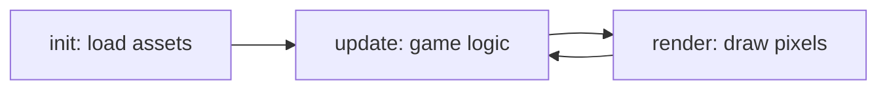

# Getting started

Transmute Core is a Java 17 engine for 2D pixel games. Start with a verified example: it includes assets, a Gradle wrapper, and a headless verification task.

## Set up

Install [Flox](https://flox.dev/docs/install-flox/) and Git, then:

```bash
git clone https://github.com/transmute-games/transmute-core.git
cd transmute-core
flox activate
./gradlew :transmute-core:publishToMavenLocal
```

Flox supplies the pinned Java and website toolchains. Without Flox, install JDK 17 and use the checked-in Gradle wrapper. Bun is only needed for repository and website checks.

## Run an example

```bash
cd examples/java/hello
./gradlew test verifyHeadless
./gradlew run
```

The first command works without a display. The second opens the game window; it needs a desktop session. Copy `examples/java/hello` to start your own project, or choose [platformer or RPG](EXAMPLES.md).

## Use the CLI

Download `transmute-cli.jar` and the wrapper for your operating system from [releases](https://github.com/transmute-games/transmute-core/releases). Put both in a directory on your PATH, and make the Unix wrapper executable with `chmod +x transmute`.

```bash
transmute new my-game -t basic -y
cd my-game
./gradlew run
```

Available templates are `basic`, `platformer`, and `rpg`. The CLI requires Java 17. Generated games resolve the engine from Maven Local or JitPack; internet access is required on the first dependency download.

## Make it yours



Implement `init()`, `update(Manager, double)`, and `render(Manager, IRenderer)` on a `TransmuteCore` subclass. Use `Manager` for assets, states, objects, and input. Put resources in `src/main/resources/` and describe them in `gamespec.properties`.

Read [game lifecycle](api/game.md) for configuration and callbacks, then [assets](api/assets.md) and [headless testing](TESTING.md).

## Troubleshooting

- **Java not found:** run `flox activate`, then `java -version`.
- **Dependency unavailable:** publish the engine locally with the command above; the examples use `mavenLocal()`.
- **No display:** run `verifyHeadless` instead of `run`.
- **CLI not found:** add the directory containing the wrapper to your PATH.
- **Missing resource:** check the path and case under `src/main/resources/`; classpath paths do not start with that directory name.
