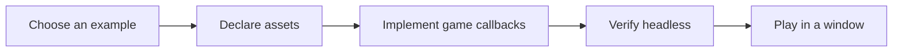

# Transmute Core documentation

Build a Java pixel game, then verify it without opening a window.

| Start here | What you will learn |
| --- | --- |
| [Getting started](GETTING_STARTED.md) | Run a verified example and create your first game |
| [Architecture](ARCHITECTURE.md) | Follow the game loop and find the right service |
| [API reference](api/README.md) | Configure games, load assets, build worlds, and test frames |
| [Examples](EXAMPLES.md) | Choose a basic, platformer, or RPG starting point |
| [Headless testing](TESTING.md) | Simulate input and assert pixels, audio, and behavior |
| [Authoring](AUTHORING.md) | Turn a manifest and assets into a game |
| [Cookbook](COOKBOOK.md) | Reuse small recipes |
| [Contributing](CONTRIBUTING.md) | Use Flox, hooks, CI, and the release process |
| [Website](WEBSITE.md) | Edit content, preview, and verify the website |

## Tutorials

1. [Hello world](tutorials/01-hello-world.md)
2. [Sprites and animation](tutorials/02-sprites-and-animation.md)
3. [Input and movement](tutorials/03-input-and-movement.md)
4. [Collision detection](tutorials/04-collision-detection.md)
5. [State management](tutorials/05-state-management.md)
6. [Audio](tutorials/06-audio-system.md)
7. [Level design](tutorials/07-level-design.md)
