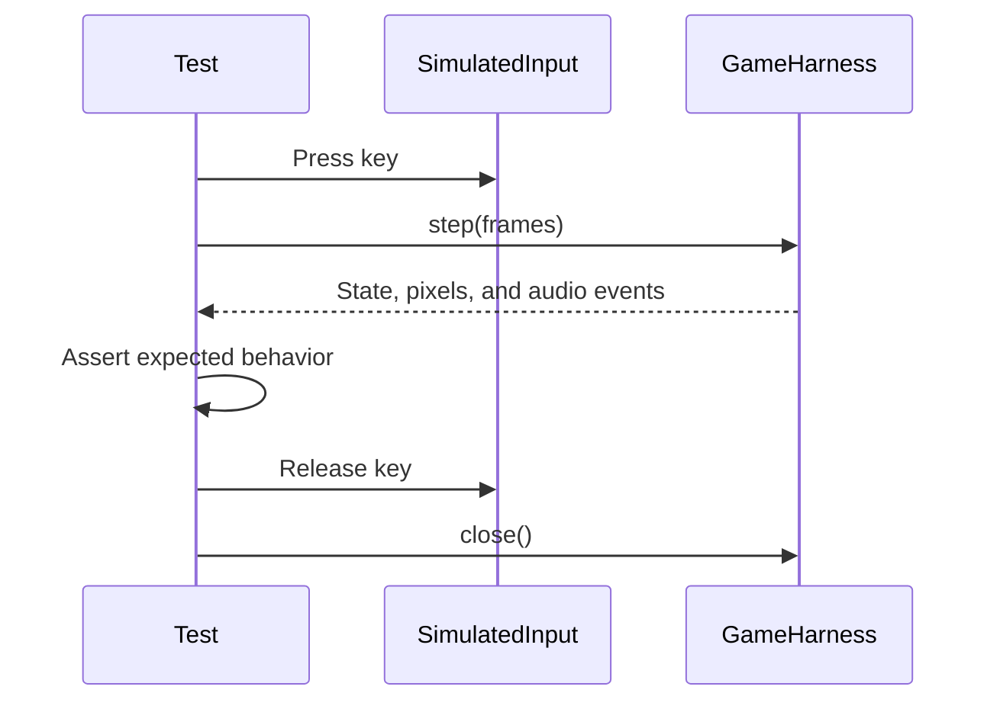

# Headless testing

Verify game behavior without a display or physical input device. Use the same example tasks locally and in CI.

## Run the suite

```bash
flox activate
bun install --frozen-lockfile
bun run check
```

This runs Markdown, link, Mermaid, LOC, shell and workflow validation; engine and CLI tests; three examples; agent-eval fixtures; website lint, types, production build, and browser checks. Install Chromium once with `bunx playwright install chromium` if you are setting up manually.

## Test a game

```bash
./gradlew :transmute-core:publishToMavenLocal
cd examples/platformer
./gradlew test verifyHeadless
```



## Choose an assertion

- Check game state when testing scores, health, or inventory.
- Use `FrameAssert` when a particular pixel or region matters.
- Use `AudioProbe` when a trigger should request a sound.
- Use `PlaytestScript` when the scenario is naturally a sequence of inputs.

See the [harness API](api/testing.md) for a minimal Java test and [evaluation fixtures](../eval/README.md) for complete scenarios. Avoid tests that merely repeat implementation details.
