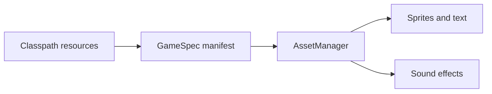

# Assets and manifests

Keep images, audio, and fonts under `src/main/resources/`. Classpath resource names are relative to that directory and case sensitive.

## Default font

```java
Manager manager = getManager();
manager.bootstrapDefaults();
AssetPack.create(manager.getAssetManager())
    .font(AssetPack.DEFAULT_FONT_RESOURCE)
    .ensureDefaultFont();
```

`AssetPack` lives in `TransmuteCore.assets`. Install a font before rendering text.

## GameSpec

```properties
title=My Game
width=320
height=180
scale=3
font=fonts/font.png
image.player=sprites/player.png
audio.jump=sounds/jump.wav
clear.r=32
clear.g=32
clear.b=64
```

Load the manifest in `init()`:

```java
GameSpec spec = GameSpec.loadClasspath("gamespec.properties");
spec.loadAssets(manager.getAssetManager());
```

`GameSpec` lives in `TransmuteCore.core`. Missing or malformed resources should be corrected at their source; do not swallow loading errors.

## Asset flow



See [authoring](../AUTHORING.md) for spritesheets and [worlds](world.md) for map keys.
